# Creative Suite Arabic

[العربية](README.md) · [Build](BUILD.md) · [Contribute](CONTRIBUTING.md) · [Licenses](LICENSE-GUIDANCE.md)

An independent Arabic/English edition of twelve open-source creative applications, with a shared launcher, ordinary Arabic typography, mixed-direction shaping/layout, and Arabic caret/selection/input fixes. User document text, project names, layer names and file paths remain user data.

This project derives from [storytold's applications](https://github.com/storytold), retaining their authors' rights. It is not an official release from those authors, Adobe, or Microsoft. Independent edition maintainer: [mahmoud0al-haddad](https://github.com/mahmoud0al-haddad).

| Application | Upstream base version |
| --- | --- |
| VectorCraft | 0.9.0 |
| PhotoCraft | 0.7.0 |
| LightCraft | 0.6.0 |
| DesignCraft | 0.6.0 |
| FilmCraft | 0.6.0 |
| EffectCraft | 0.8.0 |
| WordCraft | 0.5.0 |
| DeckCraft | 0.5.0 |
| GridCraft | 0.5.0 |
| PdfCraft | 0.6.0 |
| CADCraft | 0.5.0 |
| SoundCraft | 0.5.0 |

Launcher base: 0.2.1. Exact source revisions and credits are in [UPSTREAM.md](UPSTREAM.md) and [source-pins.json](source-pins.json).

## Install

Use the public Windows x64 Setup attached to [this repository's Releases](https://github.com/mahmoud0al-haddad/creative-suite-arabic/releases) and compare its published SHA-256. Installer targeting is Windows 10 version 1809 or later; the supplied review ran on one Windows machine and does not certify every OS/device combination.

The public package omits Microsoft runtime DLLs. Install **Microsoft Visual C++ x64 v14 Runtime 14.44.35207 or later** from [Microsoft's official page](https://learn.microsoft.com/en-us/cpp/windows/latest-supported-vc-redist). Setup checks the registered runtime, offers to open that page if needed, and rechecks when you retry. Microsoft's installer may request administrator rights. An x86-only installation does not satisfy the x64 prerequisite.

Select Arabic or English in Setup. The launcher passes its current language to each application, whose own language selector remains available. Relative bundle paths keep the install independent of build directories.

## Verification and limits

The pinned builds passed applicable build/test gates, Arabic screenshots were reviewed, and native Arabic/English startup and switching were tested alongside representative document/project save/reopen workflows using Arabic filenames. Mixed Arabic/Latin text input, caret, selection and wrapping regressions were exercised. All twelve launcher Open buttons were checked in both languages after sources were moved away from build paths.

This is evidence for those specific builds, not a claim that every upstream feature, device, plugin or future OS message is tested or fully translated. Product names, technical identifiers and user data can remain in their original language. PdfCraft's optional `cargo-deny` gate was skipped during the original review because the tool was unavailable; no comprehensive dependency-security-audit claim is made. Future source changes require a new review.

## Maintenance

Updates are reviewed and rebuilt from source. The modified launcher does not automatically replace these applications with unreviewed upstream binaries. A weekly read-only workflow reports upstream versions without opening issues, merging changes or publishing releases. Community maintenance is intended; perpetual support and immediate fixes cannot be guaranteed. Report Arabic bugs or lag using the issue templates, without private documents, credentials or sensitive settings. See [ROADMAP.md](ROADMAP.md).

## Source and licensing

Modified workspaces are under `sources/`; pinned open build inputs are under `build-inputs/`. [BUILD.md](BUILD.md) covers toolchain pins and the unmodified short-path PdfCraft dependency. Arabic strings stay in logical Unicode order and are shaped/reordered only for display.

Noto Sans Arabic is an open SIL OFL input with its license. Some Windows interfaces may read the user's installed Tahoma font at runtime; no proprietary font file is shipped. Preserve the separate MIT/Apache, dependency, font and asset notices described in [LICENSE-GUIDANCE.md](LICENSE-GUIDANCE.md).

See the [initial upstream report](validation/upstream-at-release-preparation.json) for releases available when this edition was prepared. Newer upstream versions need review and integration before becoming part of the Arabic edition.

## Arabic interface screenshots

[Project page and downloads](https://mahmoud0al-haddad.github.io/creative-suite-arabic/)

Actual modified application interfaces. Sample document content can retain its original language.

| | |
| --- | --- |
| **PhotoCraft** 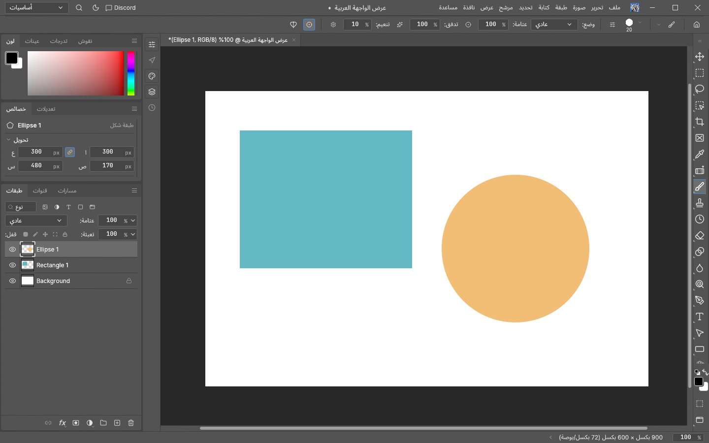 | **VectorCraft** 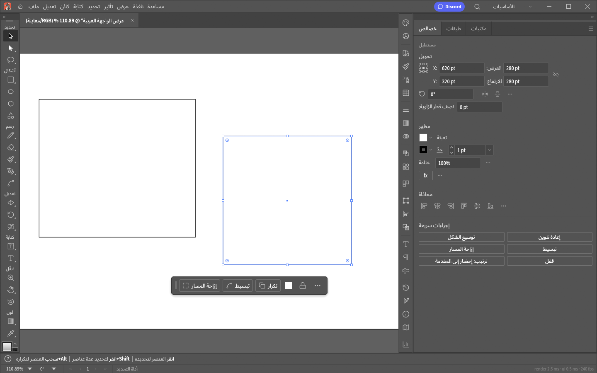 |
| **FilmCraft** 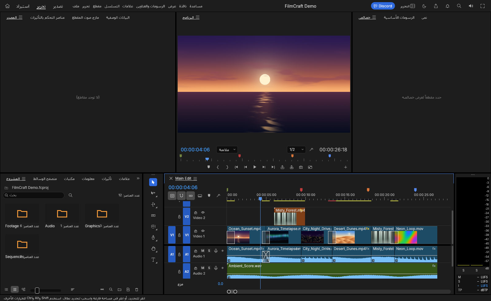 | **LightCraft** 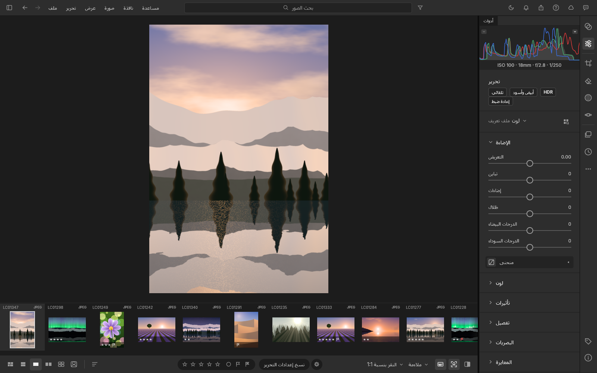 |
| **EffectCraft** 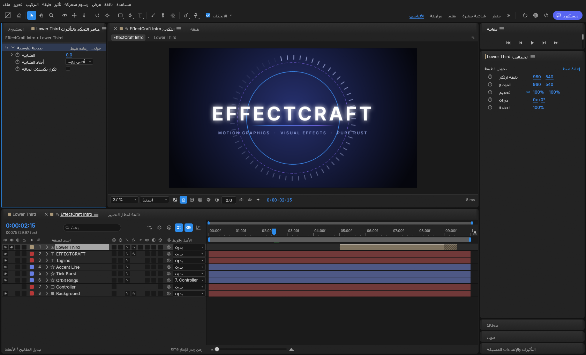 | **DesignCraft** 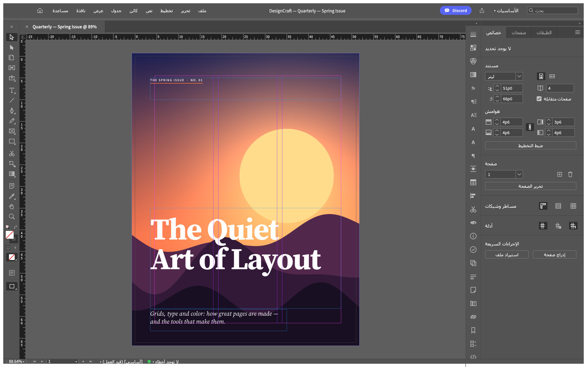 |
| **PdfCraft** 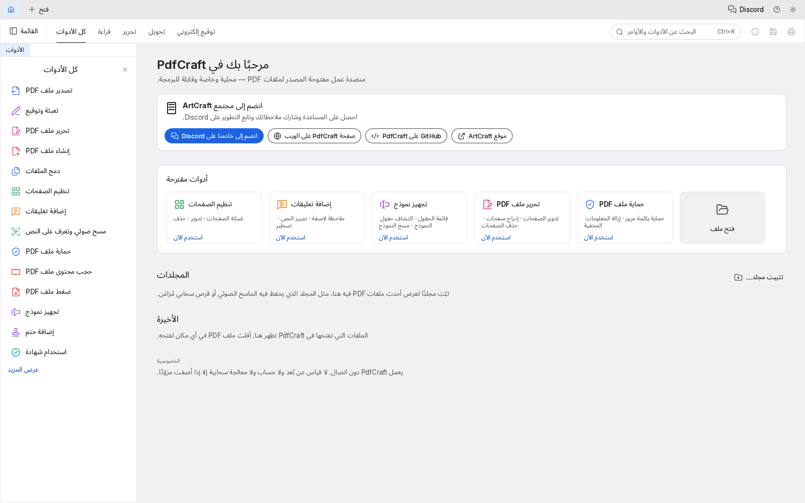 | **WordCraft** 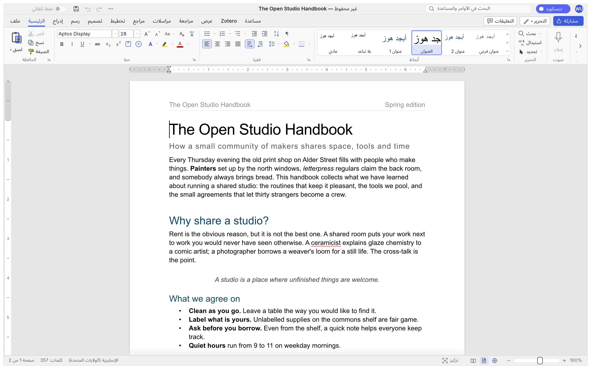 |
| **DeckCraft** 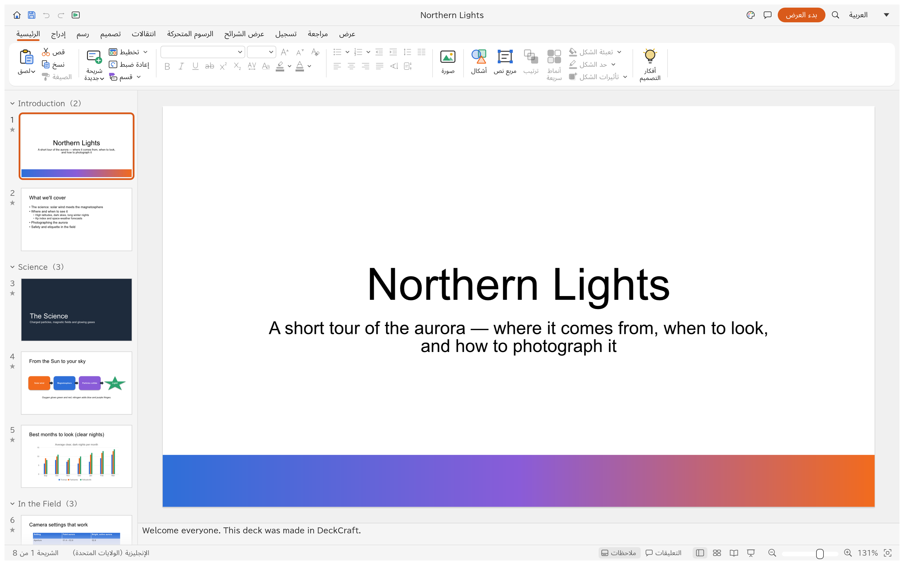 | **GridCraft** 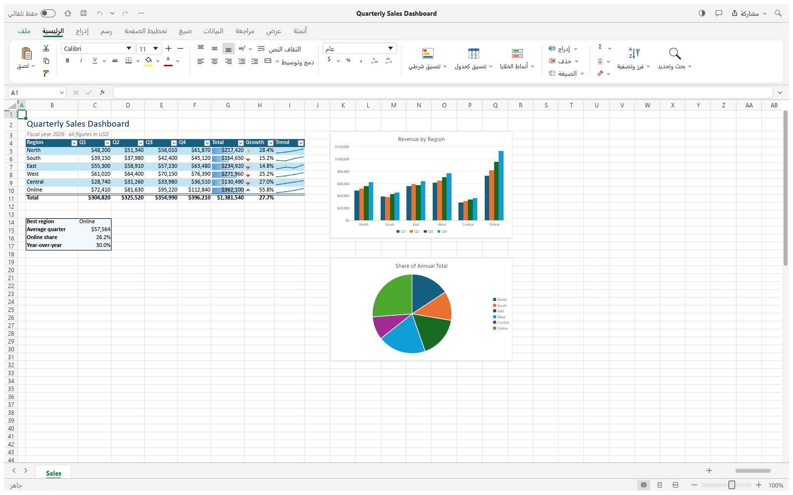 |
| **CadCraft** 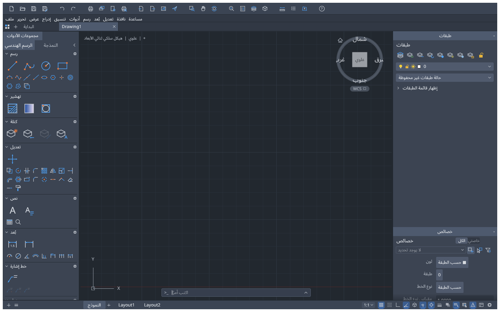 | **SoundCraft** 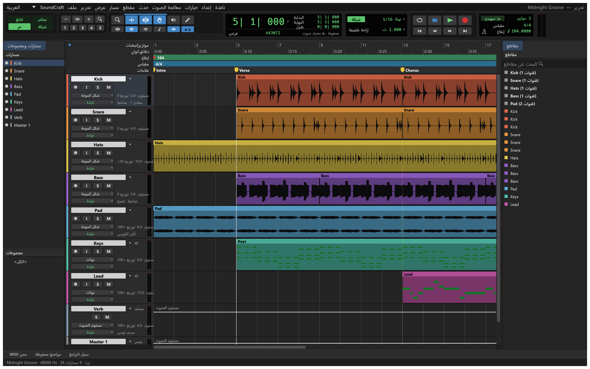 |
