# حزمة التطبيقات الإبداعية العربية

[English](README.en.md) · [البناء من المصدر](BUILD.md) · [المساهمات](CONTRIBUTING.md) · [التراخيص](LICENSE-GUIDANCE.md)

إصدار مستقل يضيف العربية إلى اثني عشر تطبيقًا إبداعيًا مفتوح المصدر، مع بقاء الإنجليزية قابلة للاختيار. يتضمن مشغّلًا موحّدًا وواجهة عربية بخط عادي، وتشكيلًا واتجاه عرض للنص المختلط، وإصلاحات للمؤشر والتحديد وإدخال النص العربي. أسماء الملفات والمشاريع والطبقات ومحتوى المستندات تبقى بيانات المستخدم.

هذا المشروع مشتق من تطبيقات [storytold](https://github.com/storytold)، ويحفظ حقوق مؤلفيها. ليس إصدارًا رسميًا منهم، ولا منتجًا من Adobe أو Microsoft. المشرف على هذا الإصدار المستقل: [mahmoud0al-haddad](https://github.com/mahmoud0al-haddad).

| التطبيق | الاستخدام | إصدار المصدر الأساسي |
| --- | --- | --- |
| VectorCraft | الرسوم المتجهة | 0.9.0 |
| PhotoCraft | تحرير الصور | 0.7.0 |
| LightCraft | تطوير الصور | 0.6.0 |
| DesignCraft | تصميم الصفحات | 0.6.0 |
| FilmCraft | تحرير الفيديو | 0.6.0 |
| EffectCraft | التركيب والمؤثرات | 0.8.0 |
| WordCraft | المستندات النصية | 0.5.0 |
| DeckCraft | العروض التقديمية | 0.5.0 |
| GridCraft | جداول البيانات | 0.5.0 |
| PdfCraft | ملفات PDF | 0.6.0 |
| CADCraft | الرسم الهندسي | 0.5.0 |
| SoundCraft | تحرير الصوت | 0.5.0 |

المشغّل مبني على الإصدار 0.2.1. مراجع المصدر الدقيقة والمساهمون موثّقون في [UPSTREAM.md](UPSTREAM.md) و[source-pins.json](source-pins.json).

## التثبيت

استخدم ملف Setup العام من [صفحة الإصدارات](https://github.com/mahmoud0al-haddad/creative-suite-arabic/releases)، وتحقق من SHA-256 المنشور معه. يدعم هذا الإصدار Windows x64؛ إعدادات المثبّت تستهدف Windows 10 الإصدار 1809 أو أحدث، لكن الاختبارات المرفقة أُجريت على جهاز Windows محدد، وليست اعتمادًا لكل جهاز أو إصدار نظام.

المثبّت العام لا يوزّع ملفات تشغيل Microsoft. يلزم **Microsoft Visual C++ Runtime x64 من السلسلة 14، بإصدار 14.44.35207 أو أحدث**. إذا لم يكن موجودًا، يعرض المثبّت خيار فتح [صفحة Microsoft الرسمية](https://learn.microsoft.com/en-us/cpp/windows/latest-supported-vc-redist)، ثم يعاد التحقق بعد تثبيته. قد يطلب مثبّت Microsoft صلاحيات المسؤول. ثبّت نسخته x64 حتى لو كانت نسخة x86 مثبتة بالفعل.

اختر العربية أو الإنجليزية في المثبّت، ثم افتح التطبيقات من المشغّل. يمرّر المشغّل لغته إلى التطبيق المفتوح؛ ويمكن تغيير اللغة داخل التطبيق أيضًا. الحزمة تستخدم مسارات نسبية لتطبيقاتها، ولا تحتاج إلى مجلدات البناء الأصلية.

## ما تم التحقق منه

تمت مراجعة الواجهات العربية والخط العادي، وتشغيل التطبيقات باللغتين وتبديل اللغة، واختبار عمليات ممثلة مثل إنشاء مستندات أو مشاريع وحفظها وإعادة فتحها بأسماء عربية. نجحت اختبارات المؤشر والتحديد والالتفاف في نص عربي مختلط باللاتينية والأرقام، واختُبرت أزرار فتح التطبيقات الاثني عشر باللغتين بعد نقل مجلدات المصدر بعيدًا عن مسارات البناء.

هذه الشواهد تخص النسخ المثبتة المحددة. لا تعني اختبار كل وظيفة أو جهاز أو إضافة خارجية، ولا ضمان خلو البرامج من الأخطاء أو التعريب الكامل لكل رسالة نظام مستقبلية. قد تبقى أسماء المنتجات والصيغ ومعرّفات البرمجة والقيم التي يكتبها المستخدم بلغتها الأصلية. احتفظ بنسخة احتياطية من أعمالك عند تجربة ميزات جديدة. فحص `cargo-deny` الاختياري لـ PdfCraft لم يُنفّذ في المراجعة الأصلية لعدم توفر الأداة؛ لا ندّعي إجراء تدقيق أمني شامل للتبعيات.

## التحديثات واستمرار التطوير

التعريب مرتبط بنسخ المصدر الموثقة. لا نستبدل النسخ المعدلة تلقائيًا بتحديث رسمي غير مراجع. التحديث الجديد يحتاج دمج تغييرات المصدر، وترجمة النصوص الجديدة، واختبار الاتجاه والإدخال والحفظ، ثم إصدار حزمة جديدة. يتوفر فحص أسبوعي **للقراءة فقط** لإصدارات المصدر؛ ينتج تقريرًا ولا يدمج تغييرات أو ينشر مسائل تلقائيًا.

نستهدف صيانة مستمرة بمساهمات المجتمع، دون وعد بدعم إلى الأبد أو ضمان إصلاح فوري. أبلغ عن أخطاء العربية أو البطء من قوالب Issues، مع اسم التطبيق والإصدار وخطوات إعادة المشكلة. لا ترفق مستندًا خاصًا أو رموز وصول أو ملفات إعدادات حساسة. راجع [خارطة الطريق](ROADMAP.md) قبل اقتراح العمل.

## المصادر والخطوط

المصدر المعدل في `sources/`، ومدخلات البناء المفتوحة في `build-inputs/`. يوضح [BUILD.md](BUILD.md) البناء المثبت الإصدارات وطريقة التعامل مع المسار القصير لتبعية PdfCraft. نص العربية محفوظ بترتيبه المنطقي في Unicode، ويُشكّل ويُرتّب عند العرض؛ لا تُعكس الكلمات مسبقًا.

خط Noto Sans Arabic المفتوح مشمول وفق SIL OFL مع ترخيصه. بعض الواجهات قد تستعمل خط Tahoma المثبت أصلًا في Windows عند التشغيل؛ ملفه ليس جزءًا من الحزمة أو المستودع. حقوق MIT/Apache والتبعيات والخطوط والأصول محفوظة بصورة منفصلة، كما يوضح [LICENSE-GUIDANCE.md](LICENSE-GUIDANCE.md).

التحديثات المنشورة لدى المصدر وقت إعداد هذا الإصدار موثّقة في [التقرير الأولي](validation/upstream-at-release-preparation.json). الإصدارات الأحدث تحتاج مراجعة ودمجًا قبل إضافتها إلى الحزمة المعربة.

## صور الواجهات العربية

[صفحة المشروع والتحميل](https://mahmoud0al-haddad.github.io/creative-suite-arabic/)

صور فعلية من الواجهات المعدّلة. محتوى المشاريع التجريبية قد يبقى بلغته الأصلية.

| | |
| --- | --- |
| **PhotoCraft** 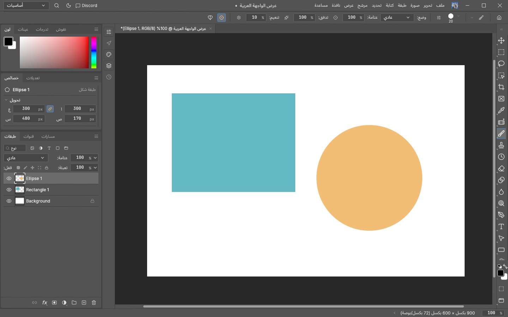 | **VectorCraft** 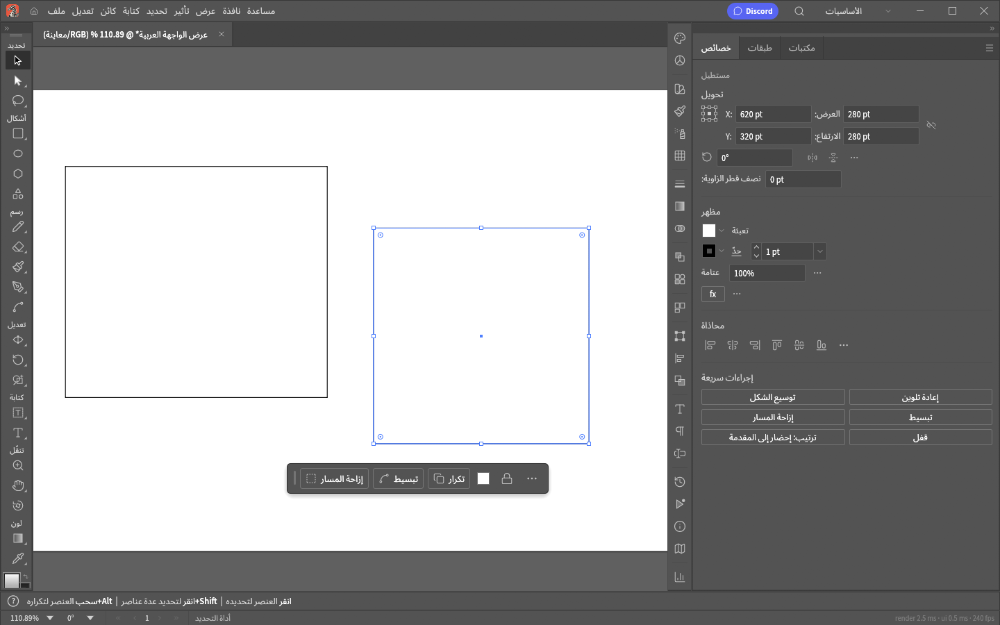 |
| **FilmCraft** 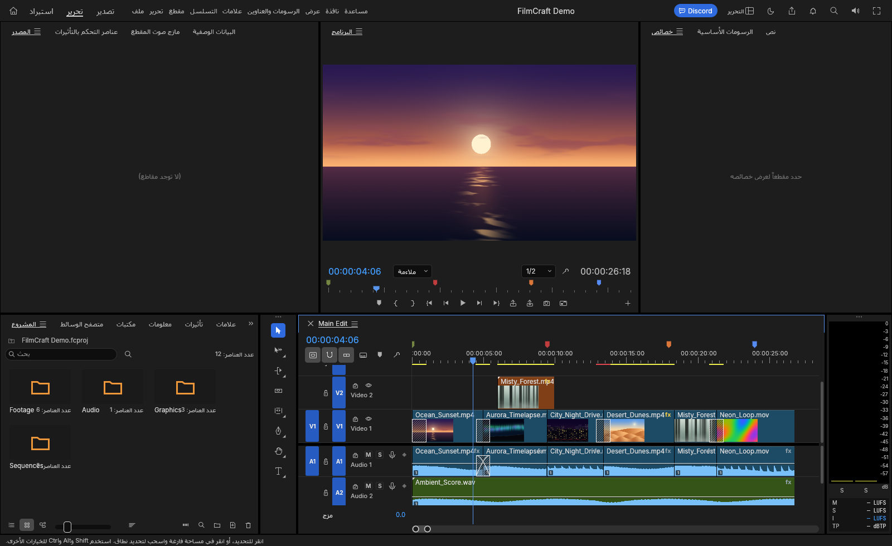 | **LightCraft** 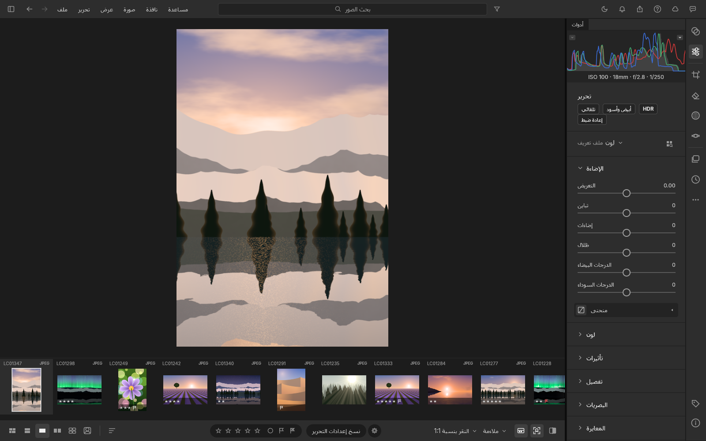 |
| **EffectCraft** 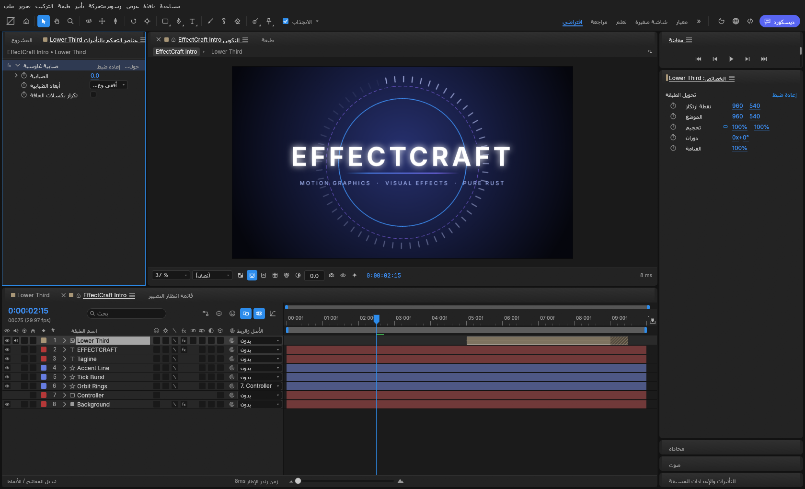 | **DesignCraft** 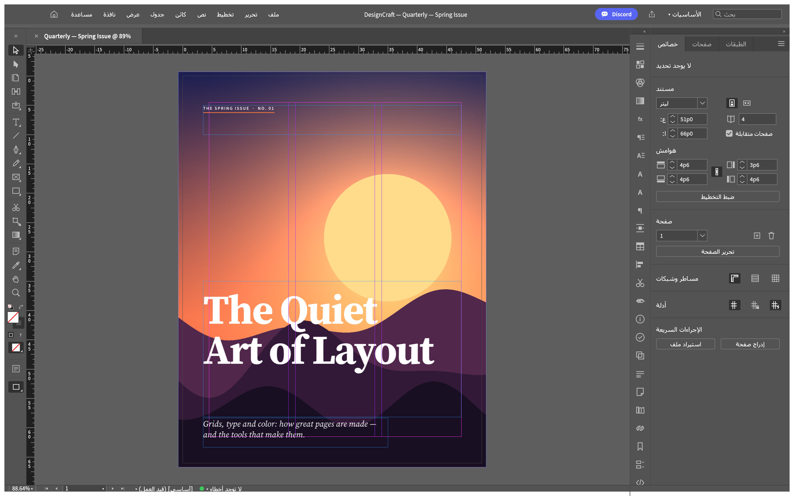 |
| **PdfCraft** 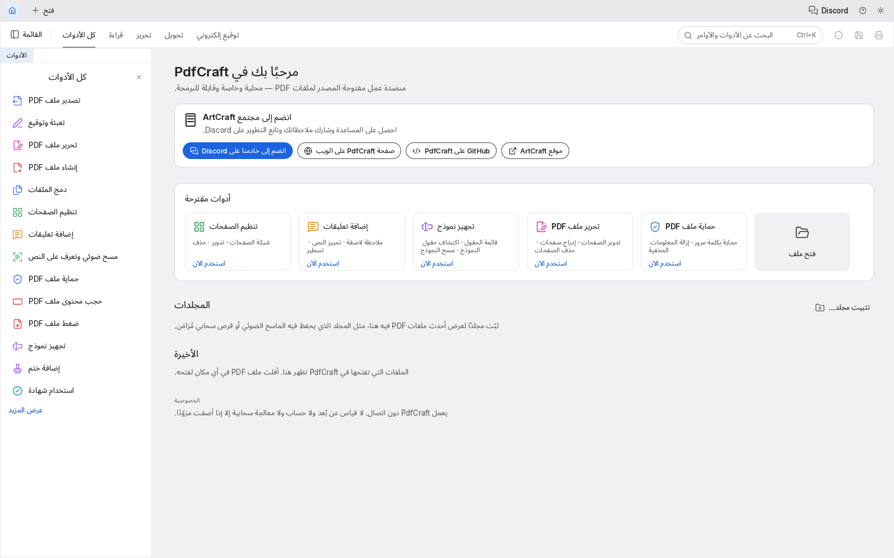 | **WordCraft** 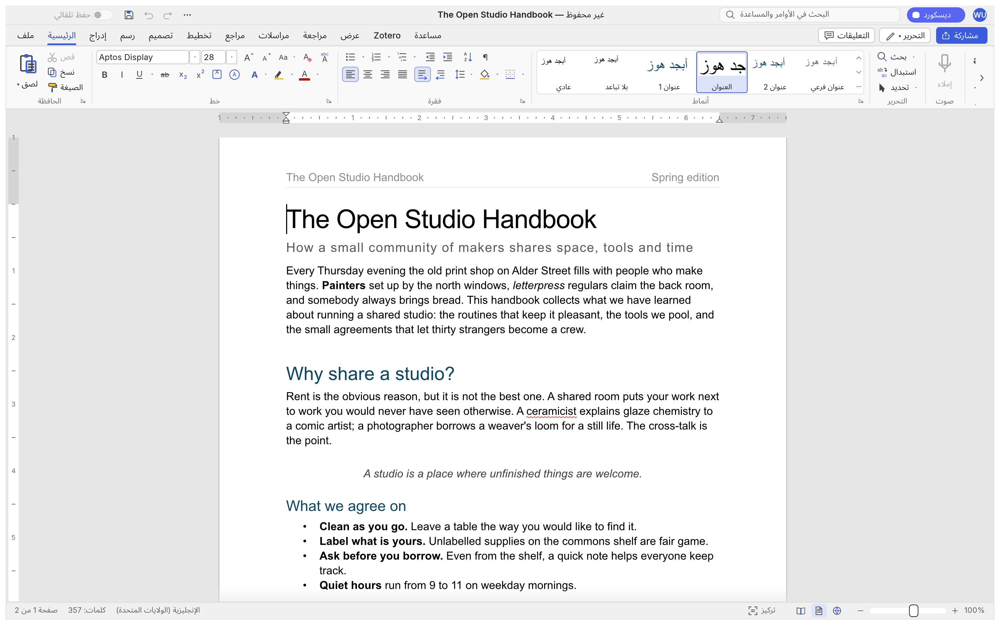 |
| **DeckCraft** 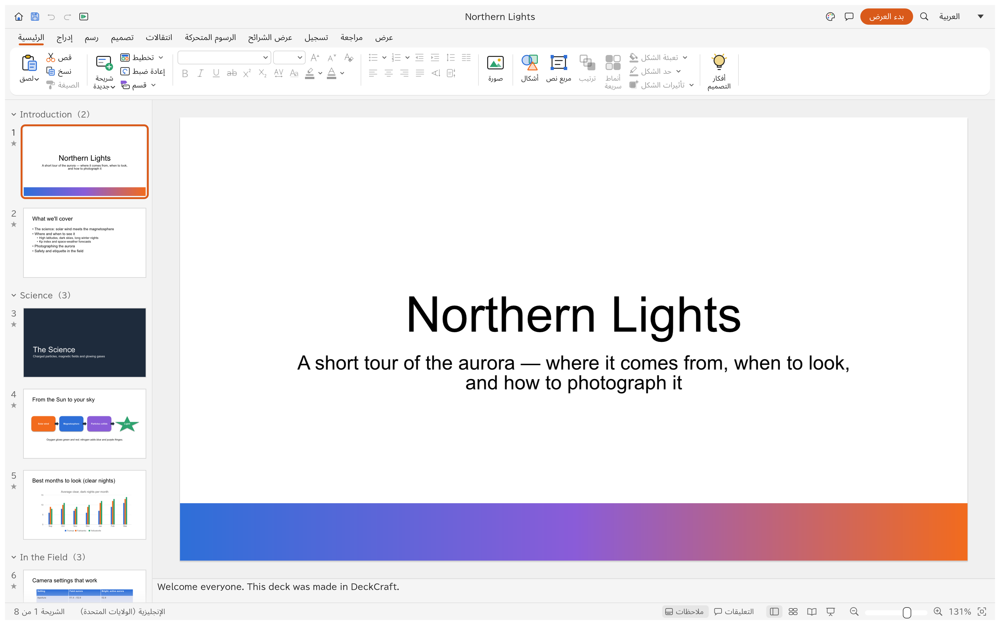 | **GridCraft** 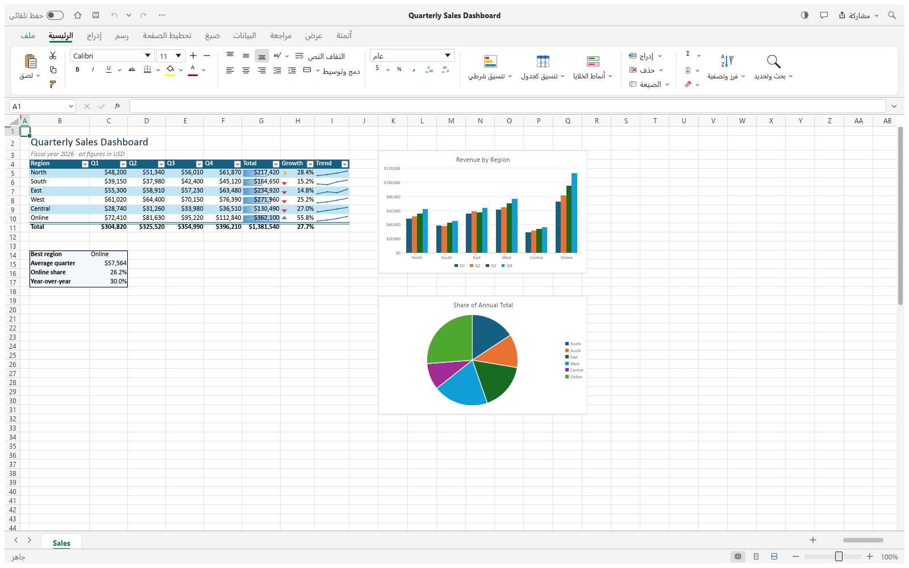 |
| **CadCraft** 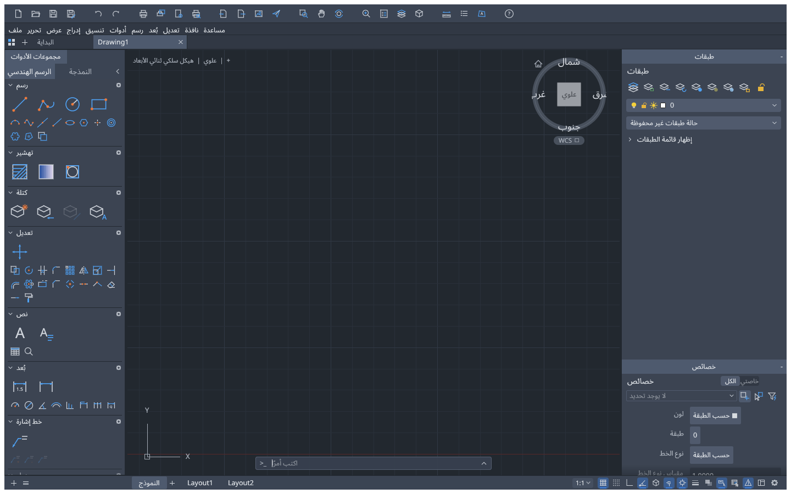 | **SoundCraft** 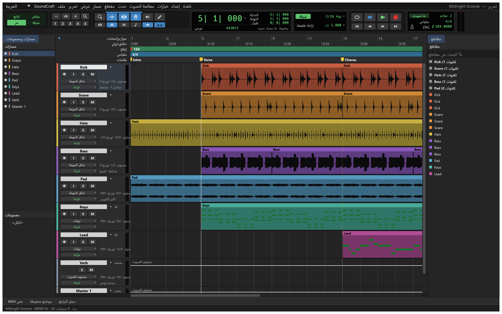 |
